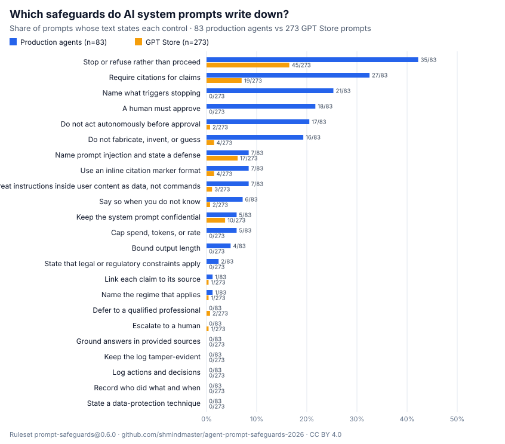

# Agent prompt safeguards 2026

**Which safeguards do real AI system prompts write down?** Per-prompt scores for 356 publicly collected system prompts against 23 written safeguards, with the script that re-runs the whole study from pinned sources.



## What the data says

- **No prompt states half of the 23 safeguards.** The highest score is 34 out of 100. Prompts behind production agents score a median of 10; GPT Store prompts score a median of 0.
- **Production prompts write down more, and the gap is not noise.** Cliff's delta is 0.614 (95% CI 0.491 to 0.729), permutation *p* = 0.0001. Dropping every zero score leaves the delta at 0.667.
- **The safeguards that separate them are about acting, not talking:**

  | Safeguard | Production agents (83) | GPT Store (273) |
  | --- | ---: | ---: |
  | A human must approve | 18 | 0 |
  | Name what triggers stopping | 21 | 0 |
  | Cap spend, tokens, or rate | 5 | 0 |
  | Treat instructions inside user content as data, not commands | 7 | 3 |

- **Five safeguards appear in no prompt at all:** grounding answers in provided sources, logging actions and decisions, keeping that log tamper-evident, recording who did what and when, and naming a data-protection technique. Looser patterns found at most 2 of 356 for any of them.

Full tables: [RESULTS.md](RESULTS.md).

## If you build agents

The four rows in the table above are cheap to add to your own agent's instructions: say which actions need a person's approval, name the conditions that make the agent stop, set a spend or token limit, and tell it that instructions inside user content or tool output are data. Then put the same rules in code, because a sentence in a prompt is a request, not a control. The five safeguards nobody writes down (audit logging especially) only exist if your code around the model implements them.

## What it measures, and what it doesn't

A score is the share of 23 safeguards a prompt's **text** states, averaged across 8 groups: prompt-injection resistance, hallucination guardrails, citation, cost limits, human approval, safe stopping, audit trail and compliance. Matching uses published regular-expression rules (ruleset `prompt-safeguards@0.6.0`), with no model, so the same text always gets the same score.

It does **not** measure whether the agent obeys its prompt, how well the prompt is written, or what controls exist in the product's code. A low score means the text is silent, not that the product is unsafe. Both source collections are leaked or aggregated sets of unknown completeness, not random samples, and both lean toward coding assistants. See [DATASHEET.md](DATASHEET.md) for the full list of limits.

## Files

| Path | Contents |
| --- | --- |
| [`data/prompts.csv`](data/prompts.csv) | One row per prompt: id, source category, collection, pinned commit, upstream path, source URL, collection date, git blob SHA-1, SHA-256 of the prompt file, size, overall score, 8 dimension scores, and a 0/1 column for each of the 23 safeguards |
| [`data/controls.csv`](data/controls.csv) | One row per safeguard: group, label, rule ids, and counts and rates per source |
| [`data/summary.json`](data/summary.json) | Distributions, the statistical test, the zero-floor check, the never-stated list, sources and licence notes |
| [`scoring/score.py`](scoring/score.py) | Re-runs the study: fetches both sources at their pinned commits, scores, and regenerates every file above |
| [`scoring/rules.py`](scoring/rules.py) | The 23 safeguards and their matching rules |
| [`METHODOLOGY.md`](METHODOLOGY.md) | Scoring formula, statistics, and the no-text guarantee |
| [`DATASHEET.md`](DATASHEET.md) | Motivation, composition, collection, uses and limits |

## Reproduce

Needs Python 3.10+ and git. No packages to install.

```bash
python scoring/score.py --check   # fetch, re-score, and confirm every committed file matches
python tests/test_dataset.py      # offline consistency checks on the committed data
```

The first command downloads the two source collections at their pinned commits into `.cache/` (ignored by git).

## Licensing

- **Data** (`data/`, `figures/`, `RESULTS.md`): [CC BY 4.0](LICENSE-DATA).
- **Code** (`scoring/`, `tests/`): [Apache-2.0](LICENSE).
- **Third-party prompt text is not in this repository.** Each row identifies its prompt by upstream path, a link to the file at a pinned commit, and content hashes, so you can fetch the exact text from its source and verify it. No prompt text or quotation from any prompt is published here, and `scoring/score.py` refuses to write output that contains any 40-character run of prompt text. The prompts belong to the vendors and GPT authors who wrote them; the collections that host them carry their own terms (see [DATASHEET.md](DATASHEET.md#licensing-of-the-sources)).

## Cite

> Hussain, S. (2026). *Agent prompt safeguards 2026: written safeguards in 356 AI system prompts* (Version 1.0.0) [Data set]. https://github.com/shmindmaster/agent-prompt-safeguards-2026

See [`CITATION.cff`](CITATION.cff). Write-up: [What 356 AI system prompts write down](https://saroshhussain.com/blog/what-356-ai-system-prompts-write-down).

## History

The study was first run with the author's earlier, now-archived prompt-scoring tool. This repository republishes it as a standalone dataset. Every per-prompt score and every summary statistic here matches that tool's output exactly. Two things changed: rows now carry the upstream path, source URL and content hashes, and the licence notes for the sources were corrected (the earlier report described them as CC0 and MIT; see the datasheet).
